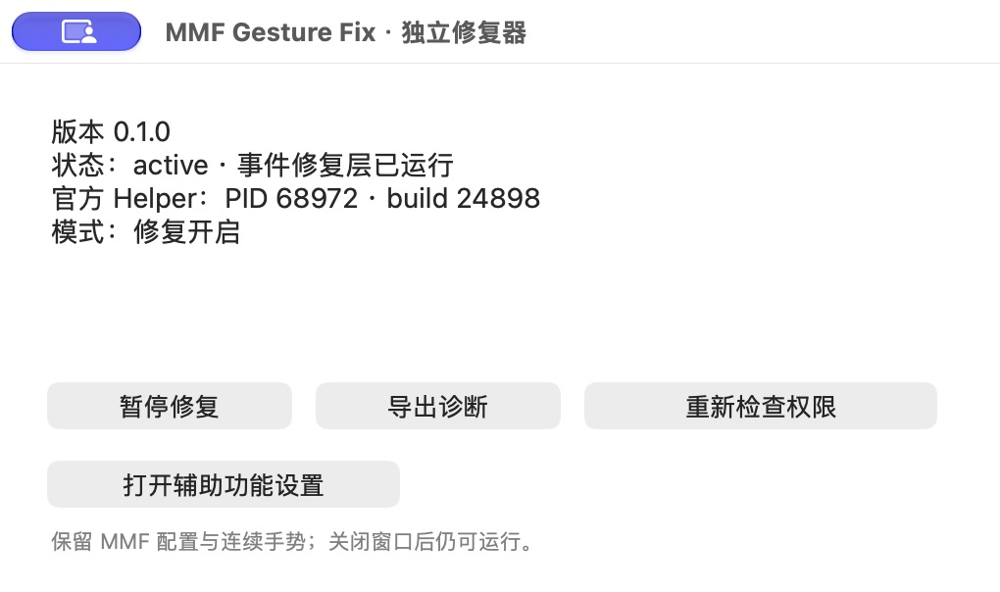

# MMF Gesture Fix

**Keep Mac Mouse Fix's continuous gestures. Correct conflicting release velocity in horizontal gestures.**

[简体中文](README.zh-CN.md) · [Download](https://github.com/timmyagentic/mmf-gesture-fix/releases/latest) · [Installation](docs/INSTALLATION.md) · [Architecture](docs/ARCHITECTURE.md)

A standalone menu bar companion for **macOS 27** and the officially signed **Mac Mouse Fix 3.1.0 Helper, build 24898**. It preserves button mappings and continuous desktop-switching gestures.



The interface defaults to English. Select **简体中文** in the control window to switch immediately; your choice is remembered across launches. The Helper PID changes between sessions.

## Install with an AI agent

> Install the latest official MMF Gesture Fix using https://raw.githubusercontent.com/timmyagentic/mmf-gesture-fix/main/docs/INSTALLATION.md. Check macOS and the official Helper version, verify the release, guide me through Accessibility permission, and report runtime status and a real paused/enabled gesture comparison. Preserve Mac Mouse Fix settings and clearly report any unverified step.

## Compatibility

| Requirement | Supported scope |
| --- | --- |
| macOS | **27** only |
| Mac Mouse Fix Helper | Official signature, build **24898** |
| Events | Horizontal native HID gesture termination / cancellation |
| CPU | Apple silicon and Intel, Universal app |
| Permission | Accessibility |

The app checks the Helper's signature, process, build and event shape. Unknown versions or sources, vertical gestures, incomplete sequences and already marked events pass through. `active` means the event tap is running; check the build and `source_supported` in `--status` for Helper eligibility.

It does not modify the official app or its configuration. It is separate from the older `mac-mouse-fix-macos-27-fix` project and has no updater, automatic login item or network activity.

## What it fixes

Some horizontal gestures end with a velocity opposing their latest movement, causing unwanted inertia, snap-back or an extra desktop transition. The app follows the continuous gesture and changes termination velocity only when a complete sequence demonstrates the conflict.

- Preserves progress, timestamps, location and modifier flags; no keyboard-shortcut replacement.
- Uses the **latest movement**, including mid-gesture reversals.
- Handles repeated termination payloads consistently and marks corrected events.
- Offers diagnostic-only mode for A/B comparison.

The original user confirmed improvement on their actual setup. Automated tests check policy and bridge behavior, not every mouse, display, OS update or future Helper. Vertical Mission Control stutter is outside this release's scope.

## Install and update

1. Download `MMF-Gesture-Fix-<version>.app.zip` from [Releases](https://github.com/timmyagentic/mmf-gesture-fix/releases/latest).
2. Extract and move **MMF Gesture Fix.app** to `/Applications`.
3. Keep official Mac Mouse Fix running, then open the companion.
4. Grant Accessibility in System Settings → Privacy & Security, then click **Recheck Permission**.
5. Confirm `active`, Helper build `24898`, and **Repair enabled**.

Public releases are Developer ID signed, Apple notarized and stapled. Each includes a SHA-256 sidecar and a source-commit manifest.

```sh
shasum -a 256 -c MMF-Gesture-Fix-0.1.1.app.zip.sha256
```

Quit the old instance using its menu bar menu before replacing the app and reopening. Updates are manual. For permission recovery, Gatekeeper and removal, read [installation and troubleshooting](docs/INSTALLATION.md).

## Controls

| Control | Meaning |
| --- | --- |
| Pause Repair / Enable Repair | Pause / enable repair; policy resets for a fresh gesture |
| Export Diagnostics | Export the bounded local diagnostic buffer |
| Recheck Permission | Retry after granting Accessibility |
| Open Accessibility Settings | Open Accessibility settings |
| English / 简体中文 | Switch interface language; remembered across launches |
| Close window | Keep running in the menu bar |
| Menu bar → Quit | Stop repair and quit; official Mac Mouse Fix remains running |

Compare paused and enabled modes using the same mapping: both directions, slow/fast movement, reversals and desktop boundaries. Avoid running multiple companions rewriting the same events.

## Privacy and CLI

No analytics, uploads or network dependencies. No keystroke, screen, window-title or clipboard recording.

Files live in `~/Library/Application Support/MMF Gesture Fix/`:

- `status.json`: process, executable path, Helper build, mode and counters. **Review the local path before sharing.**
- `gesture-diagnostics.json`: at most 256 supported event records with timestamps, source PID, phase, progress, velocity and correction flags; saved on export or quit.
- The repair switch and interface language use the companion's own UserDefaults, leaving official preferences untouched.

```sh
"/Applications/MMF Gesture Fix.app/Contents/MacOS/MMFGestureFix" --status
"/Applications/MMF Gesture Fix.app/Contents/MacOS/MMFGestureFix" --self-test
```

`--status` reads existing state without modifying it. `--self-test` only constructs events in memory and posts no input. `--export-diagnostics` asks an already running instance to export without starting another event tap.

## Build

Use macOS with Xcode Command Line Tools, Swift, Clang and the macOS SDK. Python 3 is needed only for release metadata. There are no third-party application dependencies or package downloads.

```sh
git clone https://github.com/timmyagentic/mmf-gesture-fix.git
cd mmf-gesture-fix
scripts/test.sh
scripts/build.sh
scripts/verify.sh
```

Output: `build/MMF Gesture Fix.app`; development builds use ad-hoc signing. Policy tests can run on older macOS, but HID runtime self-tests require macOS 27 and are explicitly skipped elsewhere. Such skips do not prove runtime compatibility. See [release instructions](docs/RELEASING.md).

Read [architecture](docs/ARCHITECTURE.md), [contributing](CONTRIBUTING.md), [security](SECURITY.md) and [changelog](CHANGELOG.md). Reports should include OS / Helper versions and a paused-versus-enabled comparison. Review diagnostic files before attaching them.

[MIT licensed](LICENSE). An independent community project, unaffiliated with [Mac Mouse Fix](https://github.com/noah-nuebling/mac-mouse-fix) or its author. It does not redistribute the official application or source and relies on private macOS APIs that may change.
